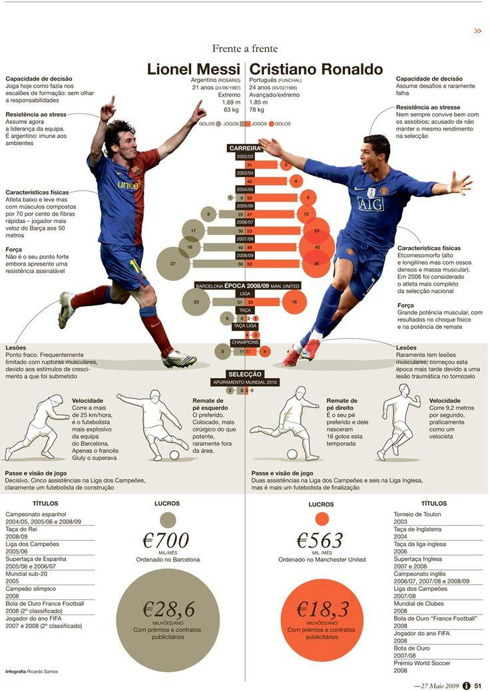

# 梅西与C罗对比图｜信息图形案例分析报告

**案例ID**：`CASE-P27-1`  · **来源**：《第三讲—信息图形类型学》PDF第27页（左图）  · **素材**：从该PDF内嵌JPEG提取，xref 184（736×1038）

## 一、先判断01：基础数据逻辑

- **主类：[编目型](../../01-信息图形数据逻辑/03-编目型信息图形概念定义.md)**。
- 判断依据：两名球员镜像站位，中央多个水平量表及统计圆标与动作剪影形成对照。
- 置信限制：01为研究者基于图面组织方式的推断，并非课件对该图的额外结构化数据标注。若仅有流程步骤，需与严格计量时间线区别。

## 二、再判断02：视觉类型标签

- **所属02视觉类型：比较型信息图形**，即课程第27页所属标签。即便视觉标签称为层级型或时间轴型，也不必强制将其底层数据逻辑归为相同名称。
- 图形特性：两名球员镜像站位，中央多个水平量表及统计圆标与动作剪影形成对照。

## 三、A. 数据结构与基础数据集

- [基础数据CSV](./CASE-P27-1-基础数据.csv)包含**14条图面对象、年份及部分定量观察记录**。这些是对图面可识别对象的结构化记录，部分属于研究者对构件的归纳，并非全部为原作者明确标注的**原始字段**，不是作者原始或完整统计数据集。
- 统一字段：`record_id`、`case_id`、`source_page`、`entity`、`entity_type`、`sequence`、`year`、`metric_name`、`value`、`unit`、`evidence_status`、`source_xref`。
- 一个单元格一个值：名称、年份、度量名、数值、单位分别建列；缺失数值不猜测。多节点关联应另建边表，而不是在同一格写多个目标。

## 四、B. 统计图形和计算逻辑

在图面中能识别的表达方式：两名球员镜像站位，中央多个水平量表及统计圆标与动作剪影形成对照。其中定量部分应按照具体指标决定是否应用频数、占比、总量、比较或时间间隔；单纯图标和说明文字不必硬性视为统计图。

**核验边界**：本PDF仅展示设计成品的压缩图像，无法反推所有精确指标；未读清的具体数值不写入CSV，也不对未知分母计算百分比。

### 图面核实的部分数值补充（PDF第27页）

图中可读到两位球员的年龄、身高、体重、每月报酬及奖金与广告年度收入。2009年的年龄与图文标注绑定，工资和广告收入使用不同单位，避免相加或误比较。

数值已按“一个单元格一项值”写入[基础数据CSV](./CASE-P27-1-基础数据.csv)，核验状态为`numeric_label_transcribed_from_pdf`。图形展示中的每个百分比都保留其原有含义，不擅自创造基数。

## 五、C. 视觉编码提炼

两名球员镜像站位，中央多个水平量表及统计圆标与动作剪影形成对照。须进一步区分**点（节点/个体）**、**线（路径/关联）**、**面（分组/数量）**、**体（空间/实体剖解）**、**象形符号**、**字级**与**色彩**究竟承担定量、定性还是装饰作用；如标注或刻度缩略无法识别，不将形状尺寸简单视为精准数量。

## 六、D. 数据／信息架构

建议将`CASE-P27-1`的数据分为“实体清单—指标/事件属性—关系/阶段—文本说明—来源”五层；先建数据字典，再将信息模块与图面对象按唯一ID关联。对该图中可辨认的实体已录入CSV，数据缺口见上。

## 七、E. 视觉叙事结构

由对峙人物切入，逐项比较中央指标及下方经济和生涯信息。观察顺序是图面可支持的视觉路径**分析**，不等同于经眼动追踪验证的实际观看顺序。

## 八、制作方法与复现流程

建立球员-指标-数值长表→保证同指标统一单位/基线→对齐两人资料→添加肖像与动作分解 → 复核数据量纲、图例、颜色一致性与可读性。

这是根据结果图形提出的**可复现设计方法**；缺乏作者原始制作日志，不能声称原作者严格使用了这些步骤或指定软件。

## 九、跨目录互链和维护

- [本标签类型说明](./说明文档.md) · [01数据逻辑定义](../../01-信息图形数据逻辑/03-编目型信息图形概念定义.md)
- [数据文件](./CASE-P27-1-基础数据.csv)
- 图像源：用户提供的课件PDF第27页，图像xref=184，非AI生成，保留图源不代表获得独立公开转载授权。
- 版本：2026-11-23 第一轮；需高清与作者数据来源复核后，再更新01/02的原则及反例。
